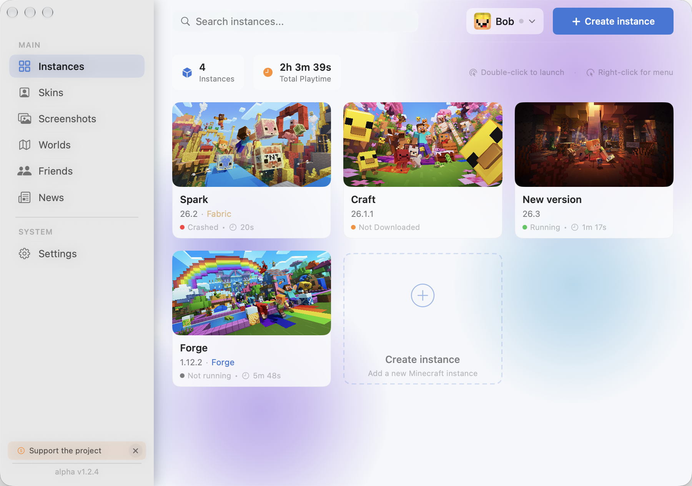

<div align="center">


# Onyx Launcher

**A fast, beautiful and friendly Minecraft launcher for macOS and Linux.**

<p>
  
  
  
  
</p>

<p>
  <a href="https://github.com/deeppacketdev-hub/onyx-launcher/releases/latest"><b>⬇️ Download</b></a>
</p>



</div>

---

## ✨ Features

### 🎮 Play your way
* **Instances:** Keep every version, modpack and world setup separate, with custom icons, per-instance settings and one-click launch.
* **All major mod loaders:** Install Fabric, Forge, NeoForge and Quilt with a single click.
* **Zero-config Java:** Onyx downloads and configures the right Java runtime for each Minecraft version and your CPU architecture. Nothing to install by hand.
* **Modpacks and migration:** Import modpacks, export instances and move your setups between versions and machines.

### 📦 Mods, packs and content
* **Unified browser:** Search and install mods, resource packs, shaders and data packs from **Modrinth** and **CurseForge** without leaving the app.
* **Compatibility filter:** Incompatible versions are hidden automatically, based on your Minecraft version and loader.
* **Dependency and duplicate checks:** Onyx tells you what a mod needs and warns you before installing something twice.

### 👤 Accounts and skins
* **Three account types:** Microsoft, **Ely.by** (with automatic skin engine injection) and offline accounts.
* **Safe by design:** Tokens are kept in the system keychain, never in plain files.
* **Skin browser:** Browse, preview in **3D**, and apply skins, offline accounts included.

### 🤝 Play with friends
* **Friends system:** Add friends, see who is online and which world they are playing in.
* **Join without port forwarding:** Worlds are shared through a peer-to-peer tunnel, so you can hop into a friend's game in one click, even across macOS and Linux.
* **LAN worlds:** Nearby worlds on your network show up automatically.

### 🧰 Everything else
* **Worlds and screenshots:** Browse, back up and duplicate worlds, and view your screenshots in a built-in gallery.
* **Picture-in-Picture:** Keep a floating window with a web page (guides, wikis) next to the game.
* **Console:** Live game logs with readable log types, for easy debugging.
* **Discord Rich Presence:** Show your active instance, version and playtime on your profile.
* **News and community polls:** Stay up to date and help shape the launcher.
* **6 languages:** English, German, Spanish, French, Polish and Ukrainian.
* **Built-in updates:** The launcher keeps itself up to date.

### 🎨 Design
A native interface with glass materials (Liquid Glass on modern macOS), smooth spring animations, an animated dynamic background and a full custom theme editor.

---

## 📦 Installation

Download the latest build from the [Releases](https://github.com/deeppacketdev-hub/onyx-launcher/releases/latest) page.

### 🍎 macOS

**Requires** macOS 14.0 (Sonoma) or newer. Works natively on Apple Silicon and Intel.

1. Download `Onyx.<version>.zip` (or the `.pkg` installer).
2. Drag **Onyx** into your `Applications` folder, or run the installer.
3. On first launch, macOS may warn about an unidentified developer, because the app is ad-hoc signed.

> [!TIP]
> To open it: right-click the app in Finder and choose **Open**. On macOS 15 and newer, go to **System Settings > Privacy & Security** and click **Open Anyway** next to Onyx.

### 🐧 Linux (Beta)

Builds are available for **x86_64** and **aarch64** as an **AppImage** and a **.deb** package.

**AppImage (any distribution):**

```bash
chmod +x Onyx_*_amd64.AppImage
./Onyx_*_amd64.AppImage
```

> [!NOTE]
> Use `Onyx_*_aarch64.AppImage` on ARM machines. AppImages need FUSE 2 (`fuse2` on Arch and Artix, `libfuse2` on Debian and Ubuntu). Without it, run `./Onyx_*_amd64.AppImage --appimage-extract-and-run`.

**Debian and Ubuntu:**

```bash
sudo apt install ./Onyx_*_amd64.deb
```

(`Onyx_*_arm64.deb` on ARM.)


**Requirements:** a 64-bit Linux desktop with a recent glibc (2.35 or newer) and WebKitGTK 4.1. Accounts are stored in the system keyring (a Secret Service provider such as GNOME Keyring or KDE Wallet).

The Linux version is a **beta**, so some things may not work on every distribution or desktop environment yet.

---

## 🛠 System requirements

| | macOS | Linux (Beta) |
|---|---|---|
| **OS** | macOS 14.0 Sonoma or newer | Modern 64-bit distribution, glibc 2.35+ |
| **CPU** | Apple Silicon or Intel | x86_64 or aarch64 |
| **Java** | Installed automatically | Installed automatically |

---

Onyx is not an official Minecraft product and is not affiliated with Mojang or Microsoft.
