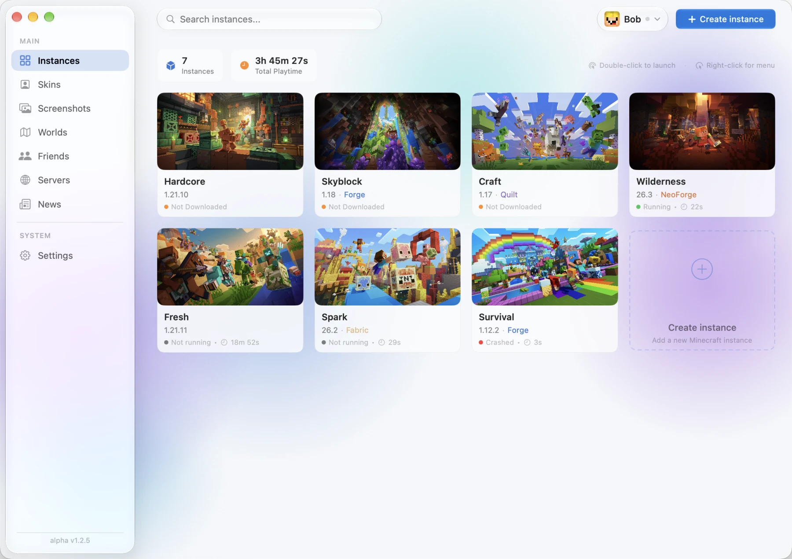
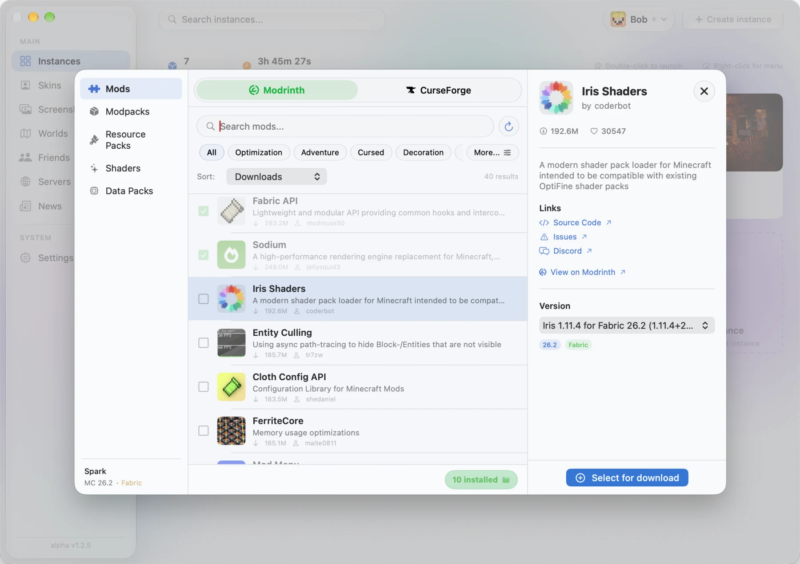
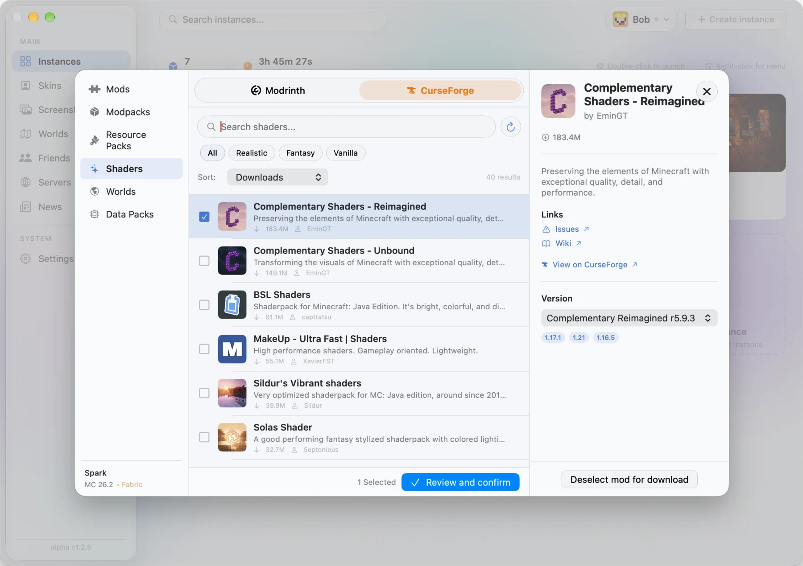
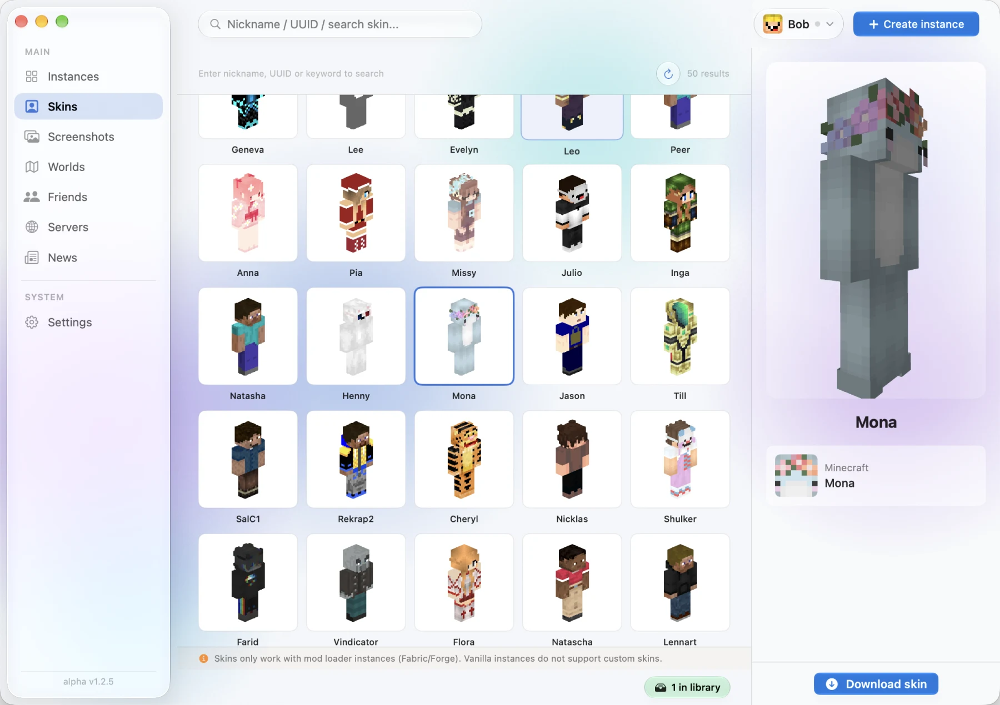
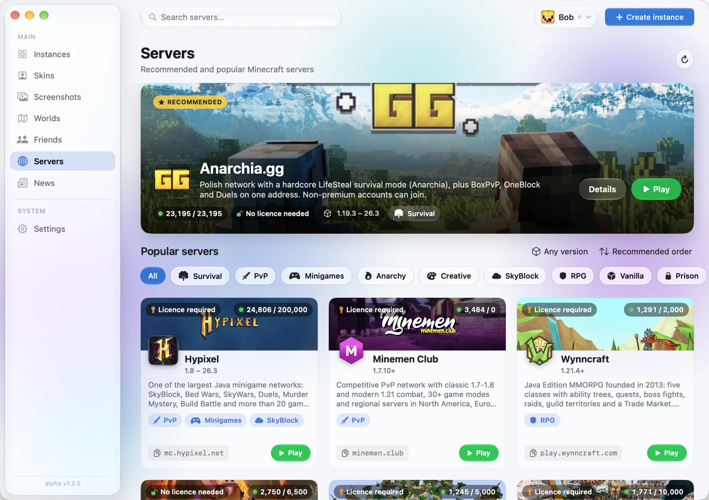
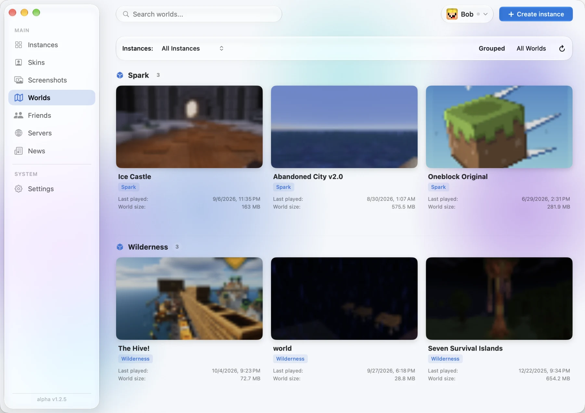
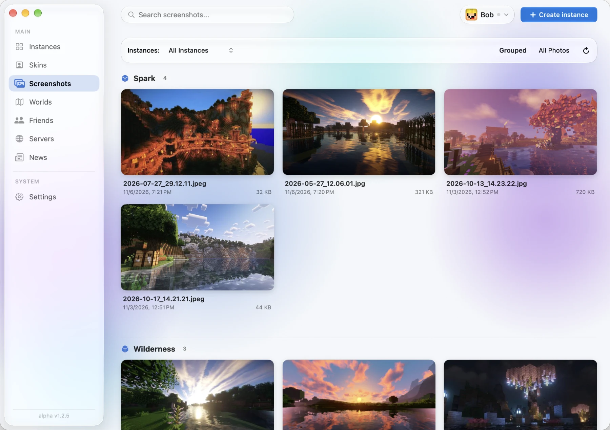
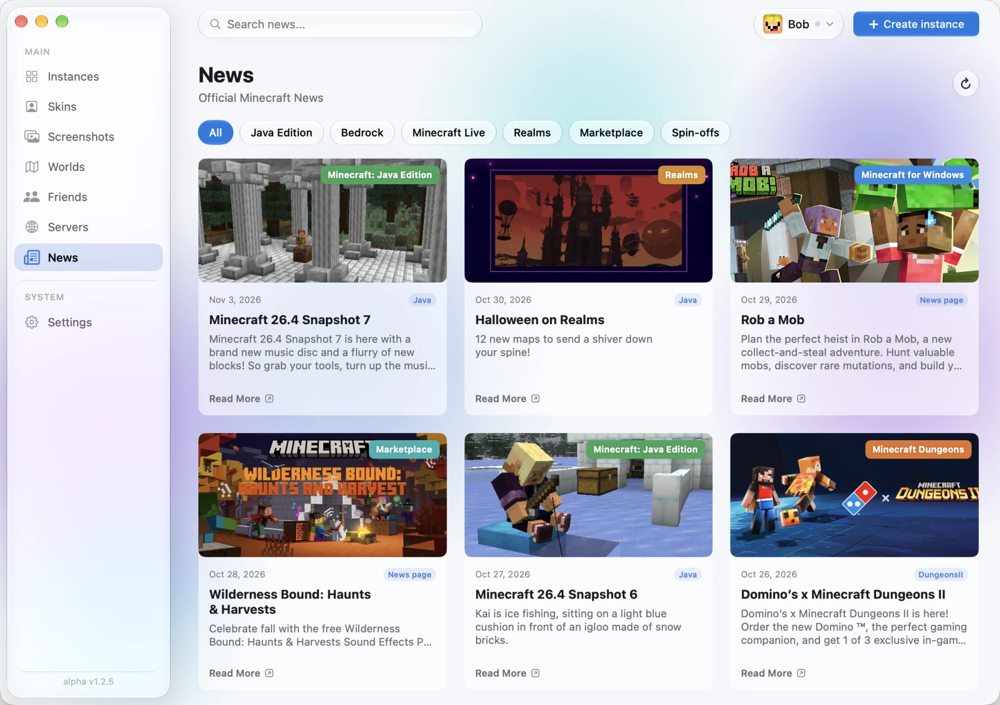

<div align="center">


# Onyx Launcher

**A fast, beautiful and friendly Minecraft launcher for macOS and Linux.**

<p>
  <a href="https://github.com/deeppacketdev-hub/onyx-launcher/releases/latest"></a>
  <a href="https://github.com/deeppacketdev-hub/onyx-launcher/releases"></a>
  
  
</p>

<h3>
  <a href="https://github.com/deeppacketdev-hub/onyx-launcher/releases/latest">⬇️ Download</a>
  &nbsp;·&nbsp;
  <a href="https://github.com/deeppacketdev-hub/onyx-launcher/wiki">📖 Wiki</a>
  &nbsp;·&nbsp;
  <a href="https://onyxlauncher.xyz">🌐 Website</a>
  &nbsp;·&nbsp;
  <a href="https://github.com/deeppacketdev-hub/onyx-launcher/issues">🐞 Report a bug</a>
</h3>

<br />



</div>

<br />

<table>
  <tr>
    <td align="center" width="25%">⚡<br /><b>Native and fast</b><br /><sub>Built for macOS with SwiftUI, universal for Apple Silicon and Intel</sub></td>
    <td align="center" width="25%">🧩<br /><b>Mods in one click</b><br /><sub>Modrinth and CurseForge with automatic compatibility checks</sub></td>
    <td align="center" width="25%">☕<br /><b>Zero-config Java</b><br /><sub>The right Java for every version, downloaded for you</sub></td>
    <td align="center" width="25%">🤝<br /><b>Play with friends</b><br /><sub>Join friends' worlds without port forwarding</sub></td>
  </tr>
</table>

---

## 🎮 Instances

Keep every version, modpack and world setup separate, with custom icons, per-instance memory, Java and window settings, and one-click launch.

- **All major mod loaders:** Fabric, Quilt, Forge and NeoForge.
- **Every version:** releases, snapshots, old betas and old alphas.
- **Upgrade with your mods:** move an instance to a new Minecraft version and Onyx finds matching versions of your mods.
- **Bring your setups along:** import from Prism Launcher, MultiMC and the official launcher, or export an instance as a ZIP.

## 📦 Mods, packs and content

One browser for **mods, modpacks, resource packs, shaders, data packs and worlds** from **Modrinth** and **CurseForge**. Only versions that fit your instance are shown, dependencies are installed with one click, and duplicates are caught before they happen.

<table>
  <tr>
    <td></td>
    <td></td>
  </tr>
</table>

## 👤 Accounts and skins

- **Three account types:** Microsoft, **Ely.by** (skin engine set up automatically) and offline.
- **Safe by design:** sign-in tokens live in the system keychain, never in plain files.
- **Skin browser:** search by nickname or UUID, preview in **3D**, build your own library and apply skins to offline accounts.

<p align="center"></p>

## 🌍 Servers and friends

- **Server catalog:** recommended and popular servers with live player counts, filters by genre and version, and one-click **Play**. Servers with their own mods are set up for you.
- **Friends:** see who is online and what they are playing.
- **Join without port forwarding:** hop into a friend's world through a direct or peer-to-peer connection, even between macOS and Linux.

<p align="center"></p>

## 🗺️ Worlds and screenshots

Browse every world from every instance, back them up, duplicate them and edit world settings like game rules, difficulty and the world border. All your screenshots live in one gallery.

<table>
  <tr>
    <td></td>
    <td></td>
  </tr>
</table>

## 🧰 And more



- **News** - official Minecraft news and patch notes.
- **Console** - the live game log, with sign-in tokens hidden.
- **Picture-in-Picture** - a floating browser for guides and videos next to the game.
- **Discord Rich Presence** - show your instance and playtime on your profile.
- **Themes** - Light, Dark, Automatic or your own, plus animated backgrounds.
- **6 languages** - English, German, Spanish, French, Polish and Ukrainian.
- **Built-in updates** - the launcher keeps itself up to date.

<br clear="right" />

---

## 📥 Installation

Download the latest build from the [Releases page](https://github.com/deeppacketdev-hub/onyx-launcher/releases/latest). Step-by-step guides are in the [wiki](https://github.com/deeppacketdev-hub/onyx-launcher/wiki/Installation).

### 🍎 macOS

1. Download `Onyx.<version>.zip` or the `.pkg` installer.
2. Drag **Onyx** into **Applications**, or run the installer.
3. Open Onyx.

> [!TIP]
> macOS may warn that Onyx is from an unidentified developer, because the app is not notarized yet. Right-click the app in Finder and choose **Open**. On macOS 15 and newer, go to **System Settings > Privacy & Security** and click **Open Anyway**.

### 🐧 Linux (beta)

Builds for **x86_64** and **aarch64**, as an **AppImage** and a **.deb** package.

```bash
# AppImage, any distribution (needs FUSE 2)
chmod +x Onyx_*_amd64.AppImage
./Onyx_*_amd64.AppImage

# Debian and Ubuntu
sudo apt install ./Onyx_*_amd64.deb
```

On ARM use `Onyx_*_aarch64.AppImage` or `Onyx_*_arm64.deb`. Accounts are stored in the system keyring (GNOME Keyring, KDE Wallet and similar).

> [!NOTE]
> The Linux version is a **beta**, so some things may not work on every distribution or desktop yet.

### 🛠 System requirements

| | macOS | Linux (beta) |
|---|---|---|
| **System** | macOS 14 Sonoma or newer | 64-bit distribution, glibc 2.35+, WebKitGTK 4.1 |
| **CPU** | Apple Silicon or Intel | x86_64 or aarch64 |
| **Java** | Installed automatically | Installed automatically |

---

## 📖 Documentation

<table>
  <tr>
    <td align="center" width="25%">🏁<br /><a href="https://github.com/deeppacketdev-hub/onyx-launcher/wiki/Getting-Started"><b>Getting Started</b></a></td>
    <td align="center" width="25%">🧱<br /><a href="https://github.com/deeppacketdev-hub/onyx-launcher/wiki/Instances"><b>Instances</b></a></td>
    <td align="center" width="25%">🧩<br /><a href="https://github.com/deeppacketdev-hub/onyx-launcher/wiki/Mods-and-Content"><b>Mods and Content</b></a></td>
    <td align="center" width="25%">👤<br /><a href="https://github.com/deeppacketdev-hub/onyx-launcher/wiki/Accounts-and-Skins"><b>Accounts and Skins</b></a></td>
  </tr>
  <tr>
    <td align="center" width="25%">🤝<br /><a href="https://github.com/deeppacketdev-hub/onyx-launcher/wiki/Friends-and-Multiplayer"><b>Friends and Multiplayer</b></a></td>
    <td align="center" width="25%">☕<br /><a href="https://github.com/deeppacketdev-hub/onyx-launcher/wiki/Java-and-Performance"><b>Java and Performance</b></a></td>
    <td align="center" width="25%">📁<br /><a href="https://github.com/deeppacketdev-hub/onyx-launcher/wiki/Files-and-Folders"><b>Files and Folders</b></a></td>
    <td align="center" width="25%">🛠️<br /><a href="https://github.com/deeppacketdev-hub/onyx-launcher/wiki/Troubleshooting"><b>Troubleshooting</b></a></td>
  </tr>
</table>

Found a bug or have an idea? [Open an issue](https://github.com/deeppacketdev-hub/onyx-launcher/issues).

---

<div align="center">
<sub>Onyx is not an official Minecraft product and is not affiliated with Mojang or Microsoft.</sub>
</div>
